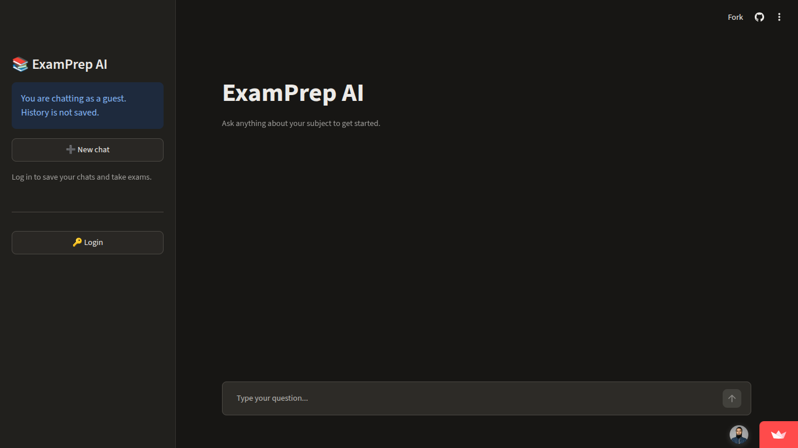
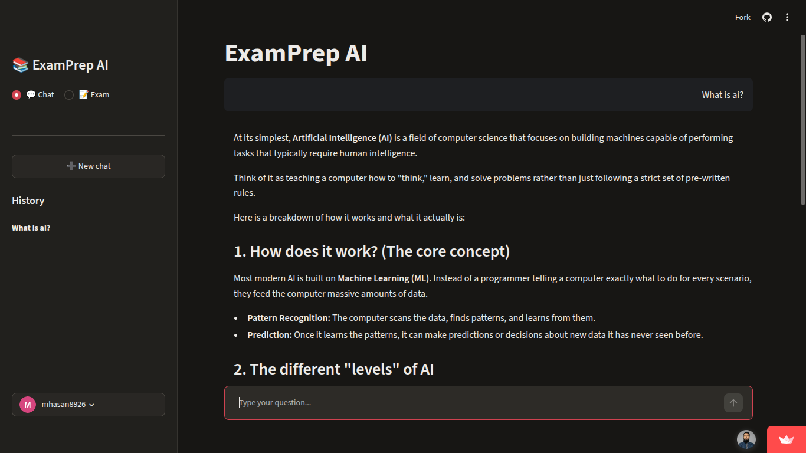
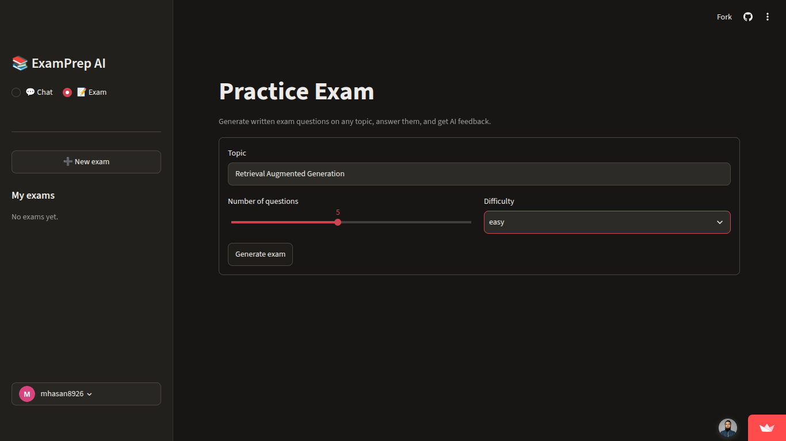
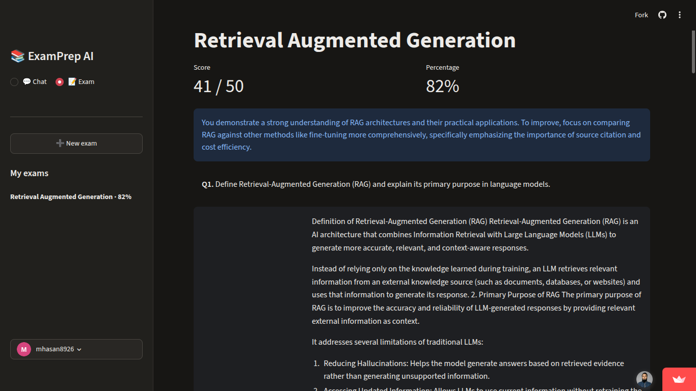
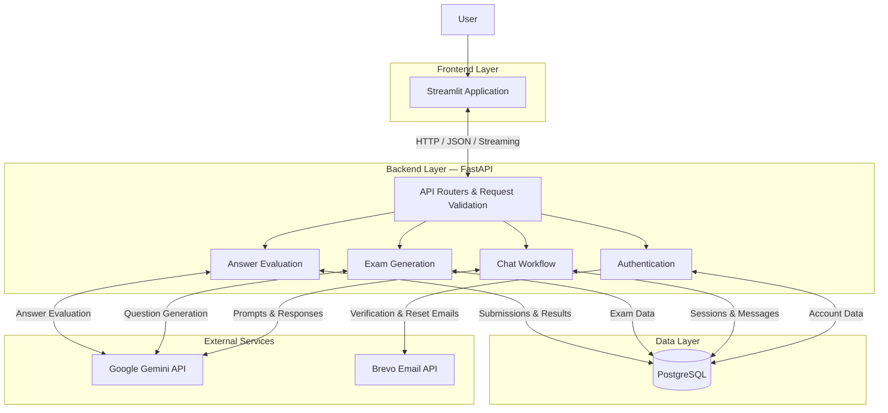
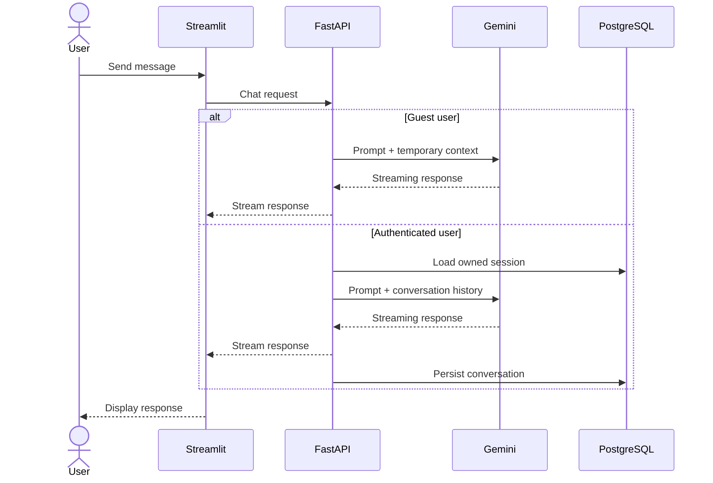
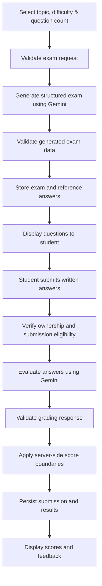
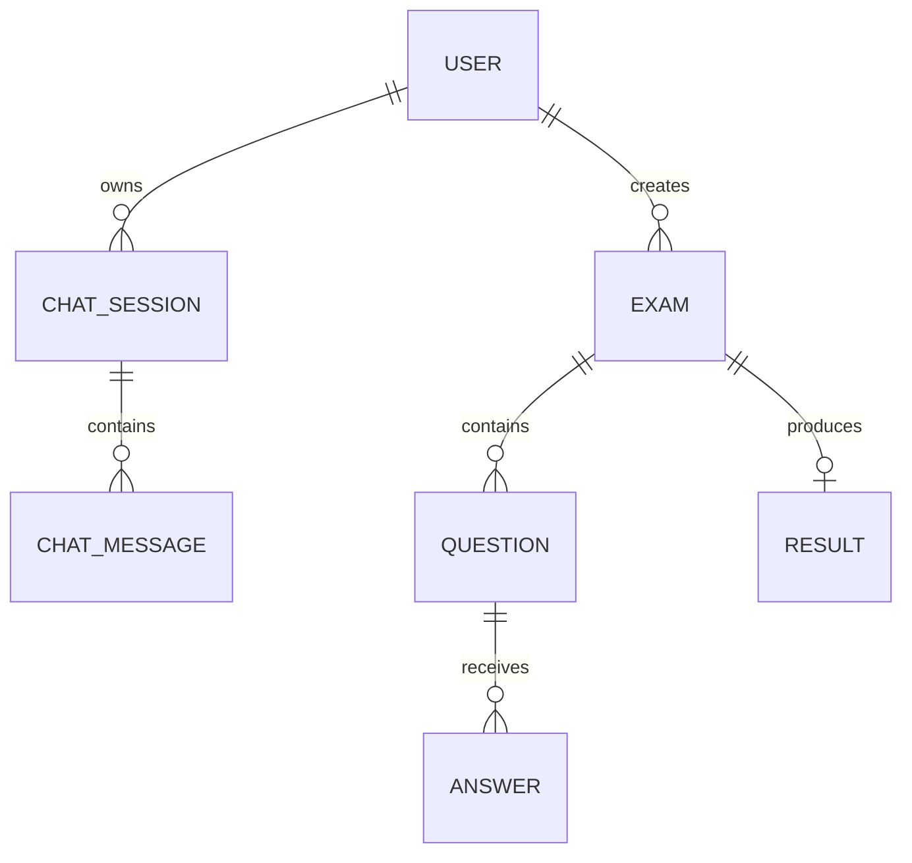

<div align="center">

# 📚 ExamPrep AI

### An AI-Powered Study Assistant for Learning, Practicing, and Evaluating Your Knowledge.

Learn through AI-powered conversations, generate personalized practice exams, submit written answers, and receive structured feedback.

[🚀 Live Demo](https://examprep-ai.streamlit.app)


</div>

> **Live Demo Notice:** The application uses free hosting. After inactivity, the first request may take some time while the backend service wakes up.

## 📸 Application Preview

<div align="center">



*Interactive AI-powered learning experience.*

</div>

---

## Table of Contents

- [Overview](#overview)
- [Core Features](#core-features)
- [Screenshots](#screenshots)
- [System Architecture](#system-architecture)
- [Application Workflows](#application-workflows)
- [Engineering and Security](#engineering-and-security)
- [Technology Stack](#technology-stack)
- [Database Design](#database-design)
- [API Reference](#api-reference)
- [Project Structure](#project-structure)
- [Getting Started](#getting-started)
- [Environment Configuration](#environment-configuration)
- [Docker Setup](#docker-setup)
- [Deployment](#deployment)
- [Testing](#testing)
- [Limitations](#limitations)
- [Roadmap](#roadmap)
- [Author](#author)

---

## Overview

ExamPrep AI is a full-stack AI-powered study assistant that supports the complete learning and practice cycle.

Instead of focusing only on answering questions, the application enables students to:

1. **Learn** — Ask questions and explore subjects through an AI-powered chat interface.
2. **Practice** — Generate customized exams based on a topic, difficulty level, and question count.
3. **Evaluate** — Submit written answers for AI-powered assessment.
4. **Improve** — Review scores, question-level feedback, and overall performance.

The application supports two types of users:

- **Guest users:** Can access AI chat without creating an account. Conversations are temporary.
- **Authenticated users:** Can access persistent chat history and saved exam records.

The backend uses FastAPI and PostgreSQL, while Google Gemini powers conversational AI, exam generation, and answer evaluation.

## Core Features

| Category | Features |
|---|---|
| AI Study Assistant | Subject-based conversations and contextual responses |
| Response Streaming | Progressive AI response delivery |
| Guest Access | Chat without account registration |
| Authentication | Registration, email verification, login, and JWT authentication |
| Chat History | Persistent conversations for authenticated users |
| Exam Generation | Custom exams based on topic, difficulty, and question count |
| Written Assessment | Submit answers for AI-powered evaluation |
| Grading & Feedback | Scores, question-level feedback, and overall results |
| Email Verification | Six-digit OTP-based account verification |
| Password Recovery | One-time password reset links |

## Screenshots

| AI Study Chat | Practice Exam |
|---|---|
|  |  |

**Exam Results and Feedback**



---

## System Architecture

ExamPrep AI follows a layered application architecture.

Streamlit handles user interaction, FastAPI manages API requests and application workflows, PostgreSQL stores persistent data, and external providers handle AI generation and transactional email delivery.



### Component Responsibilities

| Component | Responsibility |
|---|---|
| Streamlit | User interface, chat interaction, exam forms, and result presentation |
| FastAPI | API endpoints, request validation, authentication, and workflow orchestration |
| Authentication | Registration, email verification, JWT authentication, and password recovery |
| Chat Workflow | Guest and authenticated conversations, streaming, and history management |
| Exam Workflow | Question generation, reference answer management, and exam persistence |
| Grading Workflow | Answer evaluation, score validation, and feedback persistence |
| Gemini API | AI-powered conversations, exam generation, and answer evaluation |
| PostgreSQL | Persistent storage of users, conversations, exams, and results |
| Brevo | Transactional email delivery |

> **Architecture Note:** Authentication, chat, exam generation, and grading are logical modules within a single FastAPI application. They are not independently deployed microservices.

---

## Application Workflows

### 1. AI Chat

The application supports both guest and authenticated chat workflows.



- Guest conversations are temporary and are not persisted in PostgreSQL.
- Authenticated conversations are associated with the logged-in user.
- Resource ownership is checked before accessing saved conversations.

### 2. Exam Generation and Evaluation



**Important evaluation rules:**

- Questions and reference answers are generated together.
- Reference answers are stored but are not exposed to students before submission.
- Submitted answers are evaluated against the stored reference answers.
- Incomplete or invalid grading results are not persisted.
- Database constraints enforce the single-submission rule.

---

## Engineering and Security

The application includes several design decisions to handle practical backend, security, and AI integration challenges.

### Engineering Decisions

| Area | Implementation | Purpose |
|---|---|---|
| Streaming Reliability | Obtain the first AI response chunk before starting the HTTP stream | Return an appropriate HTTP error if generation cannot start |
| Session Lifecycle | Persist authenticated chat sessions after AI generation begins | Avoid saving sessions when generation fails immediately |
| Interrupted Streams | Clean up incomplete session state when streaming is interrupted | Reduce inconsistent conversation state |
| Reference Answer Protection | Keep reference answers separate from the student-facing exam response | Prevent answer exposure before submission |
| Grading Validation | Validate grading completeness and apply server-side score boundaries | Avoid blindly trusting AI-generated scores |
| Submission Integrity | Enforce single submission through database constraints | Prevent duplicate exam submissions |
| Resource Ownership | Check ownership during protected resource access | Prevent cross-user resource access |

### Authentication and Application Security

| Security Area | Implementation |
|---|---|
| Password Storage | Password hashing using `pwdlib` |
| Authentication | JWT creation and validation using PyJWT |
| Authorization | Protected endpoints use authenticated-user dependencies |
| Resource Access | Database queries enforce user ownership |
| Email Verification | HMAC-protected six-digit OTPs |
| OTP Expiration | Verification codes expire after 10 minutes |
| OTP Attempts | Maximum of five incorrect attempts |
| Password Recovery | Hashed, single-use reset tokens with a 30-minute expiry |
| Account Enumeration | Consistent forgot-password responses |
| Rate Limiting | Limits on authentication, guest chat, and email operations |
| Prompt Security | Student-submitted text is treated as untrusted input during grading |
| Secret Management | API keys and credentials are loaded from environment variables |

### Rate Limiting and Scaling

The current implementation uses in-memory rate-limit state.

This means rate-limit data is not shared across multiple application workers or instances. The current deployment therefore uses a single API worker.

A shared backend such as Redis would be a suitable next step for distributed rate limiting and multi-worker scaling.

---

## Technology Stack

| Layer | Technology | Purpose |
|---|---|---|
| Language | Python 3.12 | Application development |
| Frontend | Streamlit | Interactive user interface |
| Backend | FastAPI | REST API and workflow orchestration |
| ASGI Server | Uvicorn | FastAPI application server |
| Database | PostgreSQL | Persistent data storage |
| ORM | SQLAlchemy 2.0 | Database models and queries |
| Validation | Pydantic | Request and response validation |
| AI Provider | Google Gemini | Chat, exam generation, and grading |
| Gemini SDK | `google-genai` | Gemini API integration |
| Authentication | PyJWT | JWT creation and validation |
| Password Security | pwdlib | Password hashing |
| Email Provider | Brevo API | Transactional email delivery |
| Configuration | python-dotenv | Environment configuration |
| Testing | pytest | Automated testing |
| Containerization | Docker & Docker Compose | Containerized development |

---

## Database Design

PostgreSQL manages persistent application data.

### Core Entities

| Entity | Responsibility |
|---|---|
| User | Account and authentication information |
| ChatSession | A user's saved conversation session |
| ChatMessage | Messages associated with a chat session |
| Exam | Generated exam information and ownership |
| Question | Exam questions and reference answers |
| Answer | Student-submitted answers |
| Result | Grading results and feedback |

### Entity Relationships



The database also enforces application-level integrity requirements, including the single-submission constraint.

---

## API Reference

FastAPI provides interactive API documentation through Swagger UI and ReDoc.

| Documentation | Local URL |
|---|---|
| Swagger UI | `http://127.0.0.1:8000/docs` |
| ReDoc | `http://127.0.0.1:8000/redoc` |

### Authentication

| Method | Endpoint | Description |
|---|---|---|
| POST | `/auth/register` | Register a new account |
| POST | `/auth/verify-email` | Verify email using OTP |
| POST | `/auth/resend-otp` | Request another verification code |
| POST | `/auth/login` | Authenticate and receive an access token |
| POST | `/auth/forgot-password` | Request a password reset link |
| POST | `/auth/reset-password` | Reset account password |

### AI Chat

| Method | Endpoint | Description |
|---|---|---|
| POST | `/chat/guest` | Non-streaming guest chat |
| POST | `/chat/authenticated` | Non-streaming authenticated chat |
| POST | `/chat/guest/stream` | Streaming guest chat |
| POST | `/chat/authenticated/stream` | Streaming authenticated chat |
| GET | `/chat/sessions` | Retrieve saved chat sessions |
| GET | `/chat/sessions/{id}` | Retrieve a specific owned chat session |

### Exams

| Method | Endpoint | Description |
|---|---|---|
| POST | `/exams` | Generate a practice exam |
| GET | `/exams` | Retrieve the user's exams |
| GET | `/exams/{id}` | Retrieve a specific owned exam |
| POST | `/exams/{id}/submit` | Submit answers for grading |
| GET | `/exams/{id}/result` | Retrieve exam results |

Protected endpoints require valid authentication and appropriate resource ownership.

---

## Project Structure

```text
ExamPrep-AI/
│
├── app/
│   ├── core/
│   │   ├── settings.py
│   │   ├── security.py
│   │   ├── email.py
│   │   ├── rate_limits.py
│   │   └── gemini_client.py
│   │
│   ├── db/
│   │   ├── database.py
│   │   ├── models.py
│   │   └── init_db.py
│   │
│   ├── routers/
│   │   ├── auth.py
│   │   ├── chat.py
│   │   └── exams.py
│   │
│   ├── schemas/
│   │   ├── user.py
│   │   ├── chat.py
│   │   └── exam.py
│   │
│   └── main.py
│
├── ui/
│   └── app.py
│
├── tests/
├── docker/
├── docs/
│   └── screenshots/
│       ├── chat.png
│       ├── exam.png
│       └── result.png
│
├── .env.example
├── .gitignore
├── Dockerfile
├── docker-compose.yml
├── requirements.txt
├── requirements-dev.txt
└── README.md
```

---

## Getting Started

### Prerequisites

- Python 3.12
- PostgreSQL
- Google Gemini API key
- Brevo API key and verified sender email for real email delivery

### 1. Clone the Repository

```bash
git clone https://github.com/mahmudulhasan3/examprep-ai.git

cd ExamPrep-AI
```

### 2. Create a Virtual Environment

```bash
python -m venv .venv
```

Activate the environment:

**Linux / macOS**

```bash
source .venv/bin/activate
```

**Windows**

```powershell
.venv\Scripts\activate
```

### 3. Install Dependencies

```bash
pip install -r requirements-dev.txt -r ui/requirements.txt
```

### 4. Configure Environment Variables

Create your local environment file:

```bash
cp .env.example .env
```

Update the required credentials and configuration values in `.env`.

For local development without sending real emails:

```env
EMAIL_DEV_MODE=true
```

### 5. Initialize the Database

Ensure PostgreSQL is running and `DATABASE_URL` points to the correct database.

```bash
python -m app.db.init_db
```

### 6. Start the Backend

```bash
uvicorn app.main:app --reload
```

The API will be available at:

```text
http://127.0.0.1:8000
```

Swagger UI:

```text
http://127.0.0.1:8000/docs
```

### 7. Start the Frontend

Open another terminal and run:

```bash
streamlit run ui/app.py
```

The Streamlit application connects to the backend using `EXAMPREP_API_URL` or configured Streamlit secrets. The local API default is `http://127.0.0.1:8000`.

---

## Environment Configuration

Never commit real credentials, API keys, or secret values to version control.

| Variable | Purpose |
|---|---|
| `DATABASE_URL` | PostgreSQL connection string |
| `SECRET_KEY` | Secret used for JWT signing |
| `ALGORITHM` | JWT signing algorithm |
| `ACCESS_TOKEN_EXPIRE_MINUTES` | Access token expiration |
| `GEMINI_API_KEY` | Google Gemini API key |
| `GEMINI_MODEL_NAME` | Gemini model name |
| `BREVO_API_KEY` | Brevo API key |
| `BREVO_SENDER_EMAIL` | Verified sender email |
| `BREVO_SENDER_NAME` | Sender display name |
| `APP_BASE_URL` | Frontend URL used in email links |
| `EMAIL_VERIFICATION` | Enable or disable email verification |
| `EMAIL_DEV_MODE` | Print emails to logs instead of sending them |
| `RATE_LIMIT_ENABLED` | Enable or disable application rate limits |
| `POSTGRES_PASSWORD` | Local Docker PostgreSQL password |
| `API_PORT` | Local API port |
| `UI_PORT` | Local Streamlit port |

Refer to `.env.example` for the configuration format and required values.

---

## Docker Setup

The project supports Docker-based local development using Docker Compose.

### Build and Start Services

```bash
docker compose up --build
```

### Service URLs

| Service | Local URL |
|---|---|
| Streamlit UI | `http://localhost:8502` |
| FastAPI | `http://localhost:8001` |
| Swagger UI | `http://localhost:8001/docs` |

### View Backend Logs

```bash
docker compose logs api
```

### Run Automated Tests

```bash
docker compose --profile test run --rm test
```

### Stop Services

```bash
docker compose down
```

To remove containers and associated Docker volume data:

```bash
docker compose down -v
```

> **Warning:** The `-v` option removes the database volume and its stored data.

---

## Deployment

The application uses separate hosting services for the frontend, backend, and database.

| Component | Platform | Responsibility |
|---|---|---|
| Frontend | Streamlit Community Cloud | Hosts the Streamlit interface |
| Backend | Render | Hosts the FastAPI application |
| Database | Neon | Managed PostgreSQL database |
| AI Provider | Google Gemini | AI generation and inference |
| Email Provider | Brevo | Transactional email delivery |

### Backend — Render

**Build Command**

```bash
pip install -r requirements.txt
```

**Start Command**

```bash
uvicorn app.main:app --host 0.0.0.0 --port $PORT
```

Configure the required environment variables in the Render dashboard.

The current in-memory rate-limit implementation requires a single API worker.

### Database — Neon

Use the PostgreSQL connection string provided by Neon.

For deployment, configure the appropriate pooled connection string as `DATABASE_URL`.

Initialize the database tables:

```bash
python -m app.db.init_db
```

### Frontend — Streamlit Community Cloud

1. Connect the GitHub repository.
2. Select `ui/streamlit_app.py` as the main application file.
3. Configure `EXAMPREP_API_URL` with the deployed FastAPI base URL.
4. Add the required UI secrets.
5. Deploy the application.

The frontend and backend are deployed independently and communicate through the configured API URL.

---

## Testing

The project includes **130 automated tests** covering core backend workflows and failure scenarios.

Run the test suite locally:

```bash
pytest -q
```

### Test Coverage

| Test Area | Verification |
|---|---|
| Authentication | Registration, login, email verification, and password recovery |
| Authorization | Protected routes and resource ownership |
| Chat | Guest and authenticated chat workflows |
| Streaming | Streaming behavior and failure handling |
| Exam Generation | Generated exam data and persistence |
| Grading | Submission validation, scores, and feedback |
| Rate Limiting | Request limits and abuse protection |
| Email | Brevo request formatting and email workflows |

External Gemini and Brevo calls are mocked during automated testing. This keeps the test suite independent of external API availability and avoids unnecessary API usage.

---

## Limitations

The current implementation has several known limitations:

- **Free-tier hosting:** Cold starts may increase initial response time after inactivity.
- **In-memory rate limiting:** Rate-limit state is not shared across multiple API workers or instances.
- **Guest conversations:** Guest chat sessions are temporary and are not persisted in PostgreSQL.
- **JWT invalidation:** Password reset does not currently invalidate already-issued access tokens.
- **Database migrations:** Tables are initialized using SQLAlchemy `create_all`; Alembic migrations are not yet implemented.
- **AI-generated content:** Generated questions, answers, and feedback may contain inaccuracies and should be reviewed critically.
- **External dependencies:** AI and email functionality depends on the availability and usage limits of external providers.

## Roadmap

Planned improvements include:

- PDF and study-note uploads.
- Exam generation from uploaded study materials.
- Retrieval-Augmented Generation (RAG) for document-grounded exam generation.
- More detailed exam analytics and performance tracking.
- Redis-based distributed rate limiting.
- Alembic database migrations.
- Structured logging and monitoring.
- More comprehensive AI evaluation and grading quality assessment.

---

## Author

**Md. Mahmudul Hasan**

CSE Student | Aspiring Generative AI Engineer

[GitHub](https://github.com/mahmudulhasan3) · [LinkedIn](https://www.linkedin.com/in/mahmudulhasan03/)

---

<div align="center">

**Built with Python, FastAPI, PostgreSQL, and Google Gemini.**

[⬆ Back to Top](#-examprep-ai)

</div>
